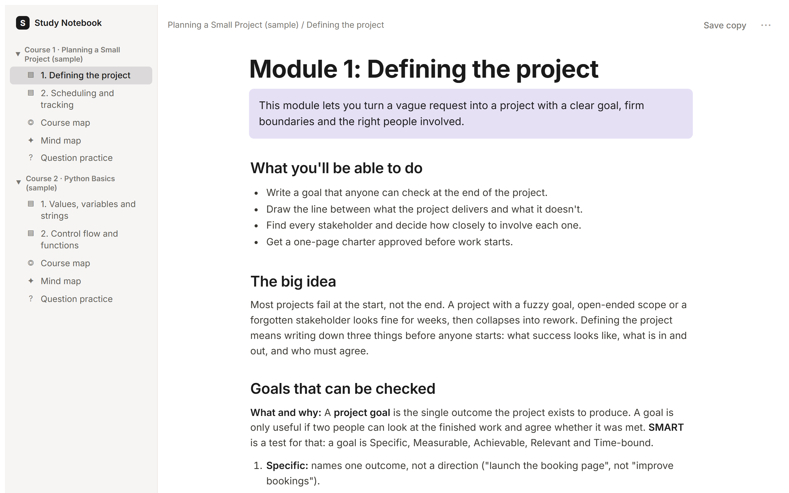
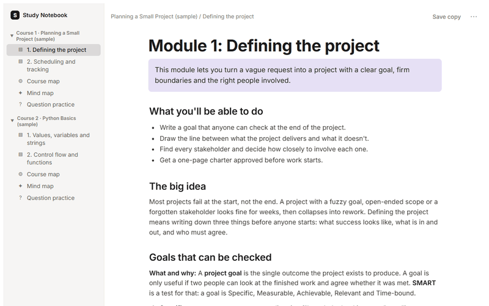
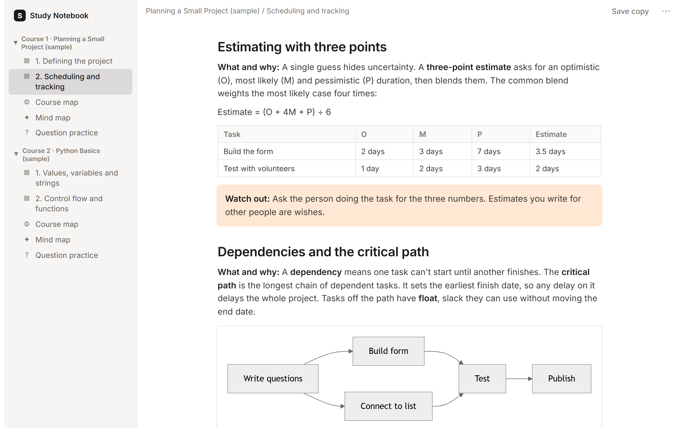
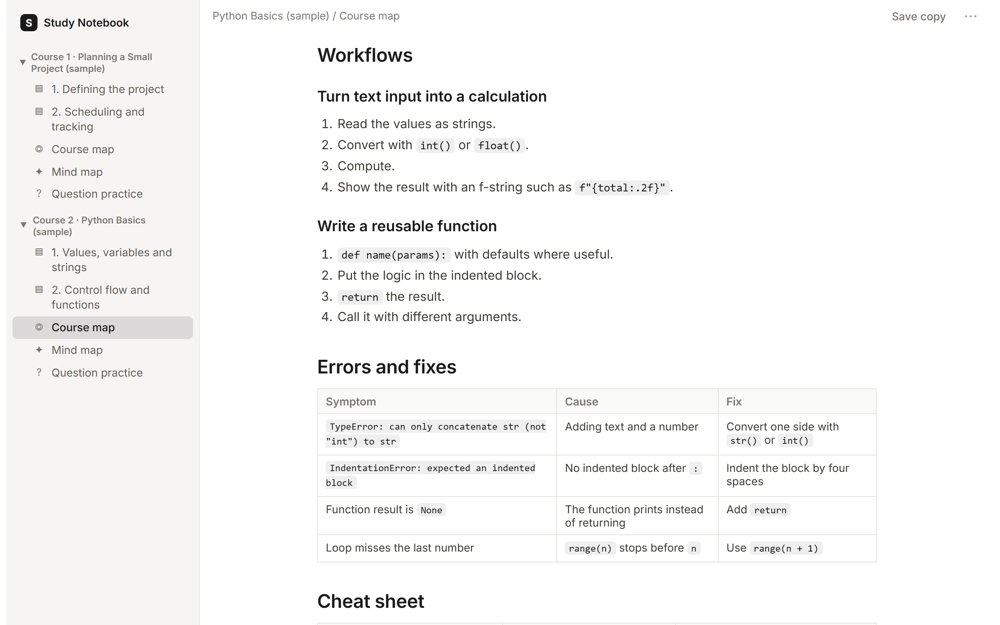
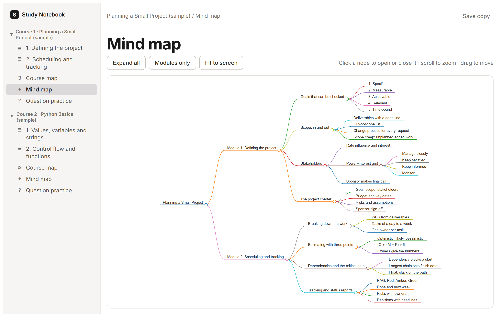
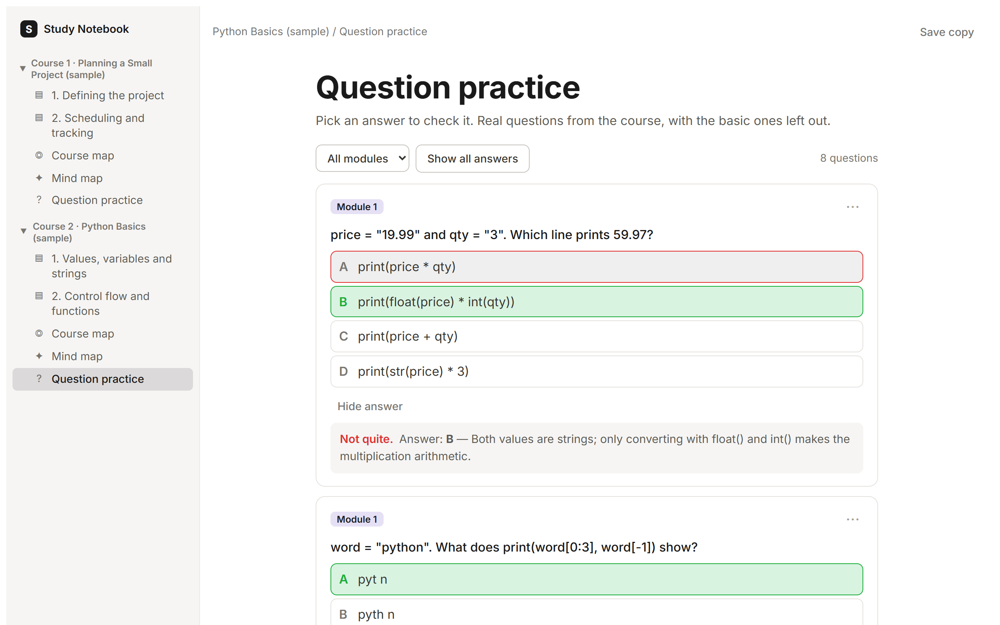
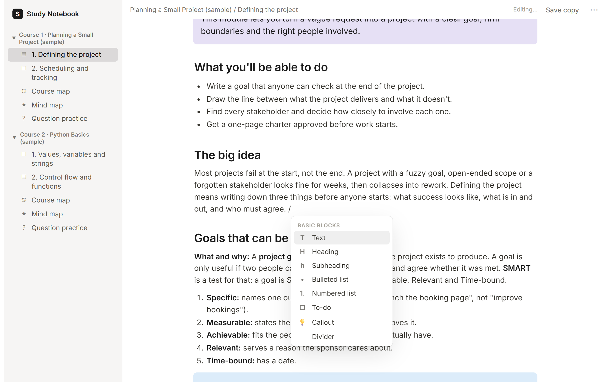
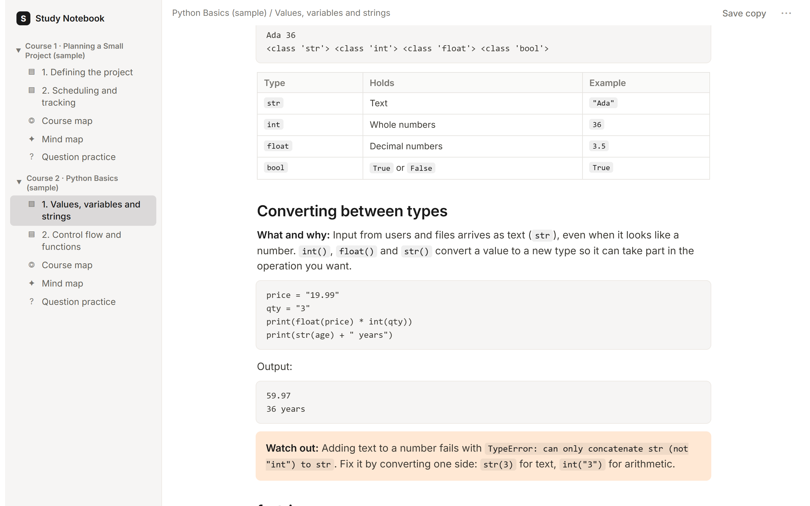
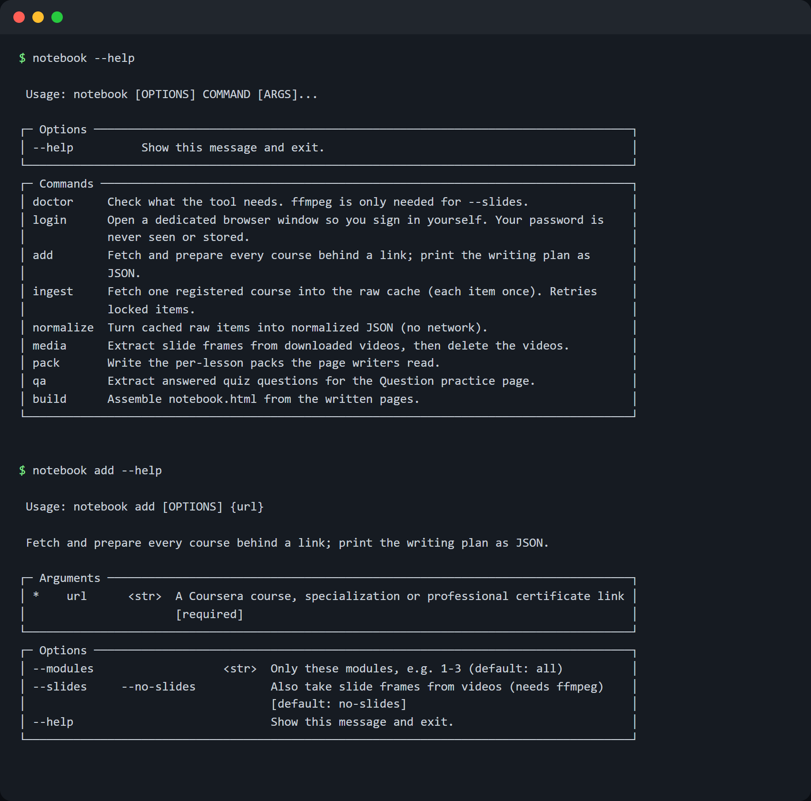
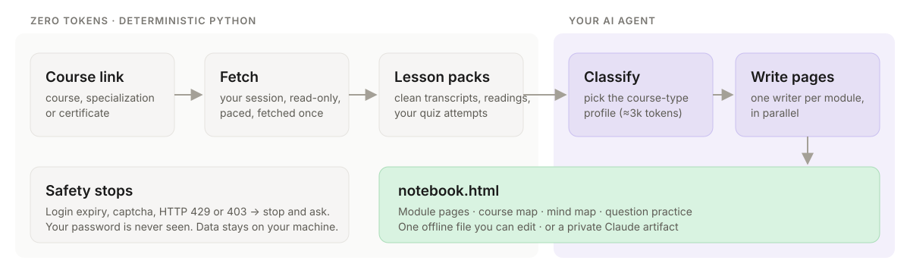

<div align="center">

# coursera-notes

**Turn the Coursera courses you're enrolled in into one notebook you can actually learn from.**
Paste a course link into your AI agent. Get back teach-first module pages, a course map, a mind map and question practice, structured for the kind of course it is.

[](https://github.com/reportedguy/coursera-notes/actions/workflows/ci.yml)
[](LICENSE)
[](pyproject.toml)
[](#install)
[](#install)
[](https://reportedguy.github.io/coursera-notes/)

**[Live demo](https://reportedguy.github.io/coursera-notes/)** · [Install](#install) · [How it works](#how-it-works) · [Course types](#adapts-to-the-course) · [FAQ](#faq)

<picture>
  <source media="(prefers-color-scheme: dark)" srcset="docs/assets/hero-dark.png">
  
</picture>

</div>

> [!NOTE]
> Every screenshot and the live demo use **original sample courses written for this repo** (`examples/sample-courses/`). They contain no Coursera content.

---

## Contents
- [Why](#why)
- [Demo](#demo)
- [Features](#features)
- [What you get](#what-you-get)
- [Adapts to the course](#adapts-to-the-course)
- [Install](#install)
- [Quick start](#quick-start)
- [How it works](#how-it-works)
- [Commands](#commands)
- [Configuration](#configuration)
- [Safety, privacy and Coursera's terms](#safety-privacy-and-courseras-terms)
- [FAQ](#faq)
- [Troubleshooting](#troubleshooting)
- [Project structure](#project-structure)
- [Roadmap](#roadmap)
- [Contributing](#contributing)
- [License and disclaimer](#license-and-disclaimer)

## Why
Course videos are slow to revisit, and transcripts are not notes. Most AI summaries go wrong in one of two ways: they're too vague to learn from, or they invent things the course never said.

**coursera-notes** gives you notes that teach. Each page explains every idea from zero, so someone who never watched the course can learn from it directly. Each page is also built only from the course's own material: transcripts, readings, downloads and the quizzes you took. Nothing is added from outside.

## Demo

<div align="center">


**[Open the live demo →](https://reportedguy.github.io/coursera-notes/)** It's the real notebook: click anything, edit any page, and try the mind map and questions.
</div>

## Features

| | |
|---|---|
| 📘 **Teach-first module pages** | Concepts explained from zero, frameworks as steps, worked examples, warnings, checklists, a recap and a glossary |
| 🧭 **Course map** | How the modules connect, core ideas, frameworks at a glance, blueprints, top takeaways, mistakes to avoid |
| ✦ **Interactive mind map** | The whole course on one screen; expand any branch |
| ❓ **Question practice** | Real quiz questions you've answered, with the basic ones dropped. Click an option to check it. |
| 🎛️ **Course-type profiles** | Business, technical, quantitative, science, language, creative, humanities and career, plus an exam add-on |
| ✏️ **Notion-style editing** | Click anywhere to edit. There's a `/` block menu, a block handle and a highlight toolbar, and edits save automatically. |
| 📄 **One offline file** | A single self-contained `notebook.html` that opens in any browser, or as a private Claude artifact |
| ⚡ **Zero-token fetching** | Fetching, cleaning and packing are plain Python. Your agent spends tokens only on writing. |
| 🛡️ **Gentle and read-only** | Paced like a person. It stops on a captcha, a login expiry, HTTP 429 or 403, and never submits anything. |
| 🔁 **Incremental updates** | Re-run after more quizzes or newly unlocked items. Nothing is fetched twice, and your edits are kept. |

## What you get

<table>
<tr>
<td width="50%" valign="top">

**Module page.** It starts with what you'll be able to do and the big idea. Each topic follows a set pattern: what and why, how, an example and a watch-out. The page ends with checklists, a recap and a glossary.


</td>
<td width="50%" valign="top">

**Course map.** One page for the whole course: how the modules connect, the core ideas, a frameworks table, blueprints, takeaways and mistakes to avoid. For technical courses it adds an errors-and-fixes table and a cheat sheet.


</td>
</tr>
<tr>
<td valign="top">

**Mind map.** Every module, topic and key point in one interactive tree, with expand, collapse, zoom and fit.


</td>
<td valign="top">

**Question practice.** Pick an answer to check it. You get a right or wrong verdict and a one-line "why". Filter by module, reset a question or delete it.


</td>
</tr>
</table>

**Editing.** Type `/` anywhere for blocks. Use the handle to add or move blocks, and select text for bold, italic and highlight. Edits save automatically, to the Claude artifact or to your browser, and **Save copy** downloads the notebook with your edits included.



## Adapts to the course
A short classification step reads the syllabus and picks a **profile** for the course. Every page writer then follows that profile, so a programming course and a management course come out structured differently:

<table>
<tr>
<td width="50%" valign="top"><b>Business</b>: frameworks, tables, warnings, checklists<br></td>
<td width="50%" valign="top"><b>Technical</b>: runnable code with real output, syntax tables, error fixes<br></td>
</tr>
</table>

| Profile | For | Module pages centre on | Course map adds |
|---|---|---|---|
| `business` | Management, PM, marketing, strategy | Frameworks as steps, comparisons, examples, checklists | Frameworks at a glance, blueprints, mistakes to avoid |
| `technical` | Programming, data, cloud, IT, security | Runnable code + output, procedures, gotchas | Errors and fixes, cheat sheet |
| `quantitative` | Math, statistics, quant finance, ML theory | Formulas with every symbol explained, worked examples step by step | Which method when, formula sheet |
| `science` | Biology, chemistry, physics, health | Mechanisms as diagrams, cause and effect, compare tables | Key mechanisms, terms and values, misconceptions |
| `language` | Language learning | Vocabulary tables, grammar patterns, phrases by situation | Grammar summary, phrase bank, core vocabulary |
| `creative` | Design, writing, music, photography | Principles, techniques, critique criteria, exercises | Technique toolkit, critique checklist |
| `humanities` | History, philosophy, literature, social science | Arguments, positions, evidence, timelines | Timeline, thinkers and positions, debates |
| `career` | Job search, communication, soft skills | Playbooks, templates and scripts, do/don't pairs | Templates, action plan |
| `+ exam` | Certification prep (an add-on flag) | Exam-objective mapping, trap callouts | Exam blueprint, final review |

The profiles live in [`prompts/profiles/`](prompts/profiles). Change the type by telling your agent (*"treat it as technical"*) or by editing `profile.json`.

## Install

**You need:**
- [uv](https://docs.astral.sh/uv/getting-started/installation/), which installs Python for you
- Google Chrome or Microsoft Edge
- a Coursera account enrolled in the course
- an AI coding agent that can run commands

Optional: [ffmpeg](https://ffmpeg.org/download.html), for slide images (`--slides`).

<details open>
<summary><b>Claude Code</b> (desktop app or CLI): recommended</summary>

```text
/plugin marketplace add reportedguy/coursera-notes
/plugin install coursera-notes@coursera-notes
```
Then ask: *"Make a study notebook from https://www.coursera.org/learn/…"*
</details>

<details>
<summary><b>OpenAI Codex CLI</b></summary>

```bash
git clone https://github.com/reportedguy/coursera-notes
```
```bash
cd coursera-notes && codex
```
Codex reads [`AGENTS.md`](AGENTS.md), which points it to the skills. Codex runs the module writers one after another rather than in parallel.
</details>

<details>
<summary><b>Gemini CLI</b></summary>

```bash
git clone https://github.com/reportedguy/coursera-notes
```
```bash
cd coursera-notes && gemini
```
Gemini reads [`GEMINI.md`](GEMINI.md), which imports `AGENTS.md`.
</details>

<details>
<summary><b>Just the CLI</b>: no agent, for the fetch-and-prepare part only</summary>

```bash
uvx --from git+https://github.com/reportedguy/coursera-notes notebook doctor
```
</details>

> [!IMPORTANT]
> Web chat apps (ChatGPT, gemini.google.com, claude.ai chat) can't run this. The tool has to drive a browser on **your** computer, with **your** Coursera session.

## Quick start



1. **Ask your agent:** *"Make a study notebook from `<course link>`"*. Course, specialization and professional-certificate links all work; a certificate is split into its courses.
2. **Sign in once.** The agent runs `notebook login` and a browser window opens. *You* sign in there, then close it. The tool never sees your password.
3. **Wait for the fetch.** It's paced on purpose, about 10–40 minutes per course, and costs zero tokens.
4. **The agent writes.** It classifies the course, then writes the module pages (in parallel in Claude Code), the course map, the mind map and the question curation.
5. **Open the notebook** at `~/StudyNotebook/notebook/notebook.html`. In the Claude app it's also published as a private artifact.

Prompts you can use:
- *"Make a study notebook from https://www.coursera.org/professional-certificates/…"*
- *"Only modules 1–2 of https://www.coursera.org/learn/…"*
- *"Include slide images."*
- *"I finished the quizzes, update my notebook."*
- *"Rewrite module 3; treat the course as quantitative."*

<br clear="right">

## How it works

<p align="center"></p>

The work is split by cost. Everything mechanical runs as deterministic Python at **zero tokens**. Your agent only does what needs judgment.

| Step | Who | What happens |
|---|---|---|
| `notebook login` | You | A dedicated browser profile; you sign in yourself (2FA and SSO work as usual) |
| `notebook add <link>` | Python | Finds the courses → fetches each item **once** (videos' English transcripts, readings, linked PDFs and documents, your quiz attempts) → normalizes → packs each lesson → extracts answered questions → writes a syllabus brief and `plan.json` |
| Course brief | Agent, ≈3k tokens | Reads the syllabus, picks the profile, writes `profile.json` |
| Module pages | Agent, 35–80k tokens each | One writer per module reads only that module's packs and follows the base prompt plus the profile. Before saving, it checks every number, count and named item against the source. |
| Course map, mind map | Agent | Built from the finished module pages |
| Questions | Agent | Drops basic questions and writes a one-line "why" for each kept one |
| `notebook build` | Python | Assembles one self-contained `notebook.html`, keeping your edits (`--live`) |

**Cost, measured on real runs:** a 4-module course takes roughly **300–450k agent tokens** for all pages, mostly on Sonnet. Fetching is free.

<details>
<summary><b>What a lesson pack looks like</b></summary>

```markdown
# Pack: <Course>, Module 2: <Module>, Lesson 1: <Lesson>

## Item 02.01.03 (lecture): <Title>
- id: `course.Xy7Qz` (frames: `frame:Xy7Qz:<n>`)
- duration: 06:12

[s0 | 00:00–00:14 | t=0] <transcript segment>
[s1 | 00:14–00:31 | t=14] <transcript segment>
…
## Item 02.01.04 (quiz): <Title>
**Q1.** <question>
  A. … B. … C. …
  your answer: B | key: B (shown)
  feedback: …
```
Packs hold everything a writer needs, so the agent never browses raw data.
</details>

## Commands

| Command | Does | Example |
|---|---|---|
| `notebook doctor` | Checks the browser, ffmpeg (optional), the data folder and the login | `notebook doctor` |
| `notebook login` | Opens the dedicated browser window for you to sign in | `notebook login` |
| `notebook add <link>` | Discovers, fetches and prepares every course behind a link; prints the plan as JSON | `notebook add https://www.coursera.org/learn/python --modules 1-2` |
| `notebook build` | Assembles `notebook.html` from the written pages | `notebook build --live saved.html` |
| `notebook ingest <course>` | Fetches one registered course again (picks up unlocked items and new attempts) | `notebook ingest python --refresh` |
| `notebook normalize <course> <mods>` | Raw responses → normalized items (offline) | `notebook normalize python 1-4` |
| `notebook media <course> <mods>` | Slide frames from downloaded videos (needs ffmpeg) | `notebook media python 1` |
| `notebook pack <course> <mods>` | Writes the lesson packs | `notebook pack python 1-4` |
| `notebook qa <course> [--apply]` | Extracts answered questions, then applies the curation | `notebook qa python --apply` |

Flags for `add`: `--modules 1-3` (default: all) and `--slides` (slide frames, needs ffmpeg).

## Configuration

| Setting | Default | How to change |
|---|---|---|
| Data folder | `~/StudyNotebook` | Set the `SV_DATA_ROOT` environment variable |
| Browser profile | your OS's app-data folder, `study-notebook/chrome-profile` | `[paths] browser_profile` in `sv.toml` |
| Pacing | 2–4 s between requests, a 20–60 s pause every 40 requests, at most 600 requests an hour | `[pacing]` in `sv.toml` |

`sv.toml` is optional and goes in `<data folder>/config/sv.toml`:
```toml
[pacing]
min_delay_s = 2.0
max_delay_s = 4.0
pause_every = 40
hourly_cap = 600
```

<details>
<summary><b>The data folder</b></summary>

```text
~/StudyNotebook/
├── config/        courses.json (registered courses), optional sv.toml
├── raw/           original responses per item and date (append-only)
├── norm/          normalized items (cleaned transcripts, readings, quizzes)
├── media/         slide frames (only with --slides; videos are deleted after)
├── state/         course manifests and per-item progress
├── registry/      skipped and locked items log
├── work/          packs/, brief/, plan.json: what the writers read
├── pages/         your pages: mNN.md, course.md, mindmap.md, profile.json, qa.json
└── notebook/      notebook.html: the result
```
</details>

## Safety, privacy and Coursera's terms

> [!WARNING]
> Coursera's Terms of Use restrict automated access. This tool is designed to be as gentle and personal as possible, but **using it may still breach those terms, and the risk to your account is yours.** Read the [Terms](https://www.coursera.org/about/terms) and decide for yourself.

How it limits that risk:
- **Your own courses only.** It reads only courses you're enrolled in, through your own signed-in session.
- **Read-only by construction.** Requests are GETs, plus exactly two allow-listed GraphQL *queries* that read your past quiz attempts. Anything else is refused in code, as is any query containing a mutation. It never enrolls, submits, starts an attempt or changes a setting.
- **Paced like a person.** There are delays between requests, periodic pauses and an hourly cap, and each item is fetched only once.
- **Stops instead of pushing.** A login expiry, captcha, HTTP 429 or a 403 on a page stops the run with a clear message. It never retries on its own, and progress is saved.
- **Your password is never handled.** You sign in yourself in a real browser window, and the session stays in a dedicated local profile.
- **Your data stays local.** Course content stays in your data folder. It's sent only to your own AI agent while that agent writes your pages.
- **Don't redistribute.** Notebooks built from paid course content are for your own study. Don't publish or share them.
- **Repo hygiene.** A pre-commit hook blocks course data (transcripts, captured pages, large files) from ever being committed here.

This project is not affiliated with, endorsed by or sponsored by Coursera.

## FAQ

<details><summary><b>Why does my notebook have no question practice?</b></summary>
Questions come from <i>your own</i> quiz attempts, which include the answers and Coursera's feedback. Quizzes you haven't attempted have no answer key. Do the quizzes, then ask your agent to update the notebook.
</details>

<details><summary><b>Some items say "locked". What does that mean?</b></summary>
Coursera locks some items, often activity exemplars, until you submit the matching activity. They're skipped without being marked as done, so the next update fetches them automatically.
</details>

<details><summary><b>Can I do one module, or one course from a certificate?</b></summary>
Yes. Ask for <i>"only modules 1–2"</i> (<code>--modules 1-2</code>), or paste the single course link instead of the certificate link.
</details>

<details><summary><b>Do I need to finish the course first?</b></summary>
No. Being enrolled is enough for videos and readings. Finishing quizzes adds question practice, and submitting activities unlocks exemplars. Update whenever you like.
</details>

<details><summary><b>Will updating overwrite my edits?</b></summary>
No. The build keeps every page you edited, and every question you deleted. Writers skip pages that already exist unless you ask for a rewrite.
</details>

<details><summary><b>How much does it cost?</b></summary>
Fetching is free. Writing uses your own agent subscription: roughly 35–80k tokens per module page, or 300–450k for a typical 4-module course. Only pages are written by the model, which is why it's cheaper than pasting transcripts into a chat.
</details>

<details><summary><b>Does it work for non-English courses?</b></summary>
It reads the English transcript track today. Other languages are on the roadmap.
</details>

<details><summary><b>Where are slide images?</b></summary>
Slide images are opt-in, because they mean downloading each video (<code>--slides</code>, needs ffmpeg). Without them, pages still include the course's reading images and the diagrams the writer draws.
</details>

## Troubleshooting

| You see | Do this |
|---|---|
| `STOPPED: Coursera asked to log in again` | Run `notebook login`, sign in, and run the same command again. Progress is kept. |
| `STOPPED: captcha or bot challenge` | Run `notebook login`, solve it in the window, wait a while, then re-run |
| `STOPPED: HTTP 429` | You were rate-limited. Wait at least an hour, then re-run, and consider raising the delays in `sv.toml`. |
| `skipped <course>: …` in the plan | Usually not enrolled. Enroll on Coursera yourself, then re-run. |
| `[MISS] browser` in `doctor` | Install Google Chrome or Microsoft Edge |
| `--slides needs ffmpeg` | Install ffmpeg, or drop `--slides` |
| `login … NOT logged in` | The window was closed before sign-in finished. Run `notebook login` again. |
| A page claims something the course didn't say | Edit it in place, or ask the agent to rewrite that module. Please also open an issue with the profile type. |

## Project structure

```text
coursera-notes/
├── .claude-plugin/        plugin.json + marketplace.json (Claude Code install)
├── skills/                agent skills (Agent Skills standard: Claude Code, Codex, Gemini CLI)
│   ├── study-notebook/    entry point: link in, notebook out
│   ├── course-brief/      classify the course → profile.json
│   ├── write-module/      one teach-first module page
│   ├── write-course-pages/course map + mind map
│   └── curate-questions/  keep the good questions, write the "why"
├── agents/page-writer.md  subagent used for parallel writing in Claude Code
├── prompts/               base prompts + profiles/ (the writing rules)
├── src/sv/                the `notebook` CLI (fetch, normalize, pack, build)
│   ├── coursera_adapter.py    the only code that knows Coursera URLs (read-only guard)
│   ├── browser.py             session, pacing and safety stops
│   ├── add.py                 link → courses → plan.json
│   ├── template.html          the notebook app (editor, mind map, questions)
│   └── graphql/               the two read-only quiz queries
├── examples/sample-courses/   original sample courses used for the demo
├── tools/                 demo build, screenshot capture, pre-commit guard
├── docs/                  GitHub Pages live demo + README assets
└── tests/                 offline tests (no network, no Coursera)
```

## Roadmap
- [ ] Tested install guides for Codex CLI and Gemini CLI (works by design, but community reports are welcome)
- [ ] Non-English transcript tracks
- [ ] More sources behind the same pipeline, such as edX and Udemy adapters
- [ ] More profiles: health sciences, law, design critique
- [ ] Spaced-repetition review mode inside the notebook
- [ ] Export to Markdown or PDF from the notebook

Have an idea? [Open a feature request](https://github.com/reportedguy/coursera-notes/issues/new/choose).

## Contributing
Contributions are welcome, especially new course-type profiles and agent install reports. Read [CONTRIBUTING.md](CONTRIBUTING.md) first. The one hard rule: **never commit course content.**

```bash
uv sync --all-extras
```
```bash
uv run pytest
```
```bash
uv run python tools/build_demo.py && uv run python tools/capture_demo.py
```

Security issue? See [SECURITY.md](SECURITY.md). Please don't open a public issue for it.

## License and disclaimer
[MIT](LICENSE) © reportedguy.

Coursera is a trademark of Coursera, Inc. This is an independent, unofficial tool for personal study, not affiliated with or endorsed by Coursera. You are responsible for how you use it and for following the terms of the platforms you use.
