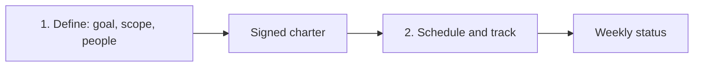

> This course lets you take a small project from a one-line request to a tracked schedule that finishes when you said it would.

## How the course fits together
**Module 1, Defining the project**, turns a request into a checkable goal, a scope with clear edges and a map of the people involved, all captured in a signed charter. Nothing gets scheduled until those three things are agreed.

**Module 2, Scheduling and tracking**, breaks the charter's deliverables into estimated tasks, finds the chain that sets the finish date, and keeps the forecast honest with weekly status reports.

## Core ideas

### A goal you can check
A **SMART** goal is Specific, Measurable, Achievable, Relevant and Time-bound. If two people can't agree at the end whether it was met, it isn't a goal yet.

### Scope has two edges
**Scope** lists what you deliver; the **out-of-scope list** names what you won't. A **change process** decides every new request, which is what stops **scope creep**.

### People before tasks
Rate every **stakeholder** by influence and interest, and engage each quadrant of the **power–interest grid** differently. The **sponsor** signs the **charter** and makes final calls.

### Forecast with ranges
**Three-point estimates** ((O + 4M + P) ÷ 6) replace single guesses. The **critical path** is the longest dependent chain and sets the finish date.

### Report early
A weekly **RAG status** report surfaces problems while they are still cheap. Two weeks of Amber means escalate.

## Frameworks at a glance
| Framework | Steps or parts | Use it when |
|---|---|---|
| SMART goal | Specific, Measurable, Achievable, Relevant, Time-bound | Writing or reviewing any goal |
| Power–interest grid | Manage closely, keep satisfied, keep informed, monitor | Deciding how to involve each stakeholder |
| Project charter | Goal, scope, stakeholders, budget and dates, risks, sign-off | Before any work starts |
| WBS | Deliverables → parts → tasks of a day to a week | Turning scope into work |
| Three-point estimate | O, M, P → (O + 4M + P) ÷ 6 | Estimating any uncertain task |
| RAG status report | Status, done/next, risks, decisions | Every week |

## Blueprints

### Starting a project
- [ ] Rewrite the request as a SMART goal and confirm it.
- [ ] List what is in scope and what is out.
- [ ] Map stakeholders on the power–interest grid.
- [ ] Get the one-page charter signed by the sponsor.

### Building the schedule
- [ ] Break deliverables into tasks of a day to a week, each with an owner.
- [ ] Collect three-point estimates from the owners.
- [ ] Mark the critical path and the milestones.

### Running the week
- [ ] Send the RAG report with risks, owners and decisions.
- [ ] Route every new request through the change process.
- [ ] Escalate anything Amber for two weeks.

## Top takeaways
- Define before you plan: goal, scope, people.
- A goal without a number invites endless debate.
- The out-of-scope list protects you as much as the scope.
- No signature, no authority.
- Small tasks reveal delays early; month-long tasks hide them.
- Ask task owners for estimates, as ranges.
- Watch the critical path, not every task equally.
- Amber twice means escalate.

## Mistakes to avoid
- Starting work before the sponsor signs the charter.
- Accepting "small" changes outside the change process.
- Forgetting a stakeholder who is affected but quiet.
- Writing estimates for other people's tasks.
- Leaving a project Amber week after week without escalating.
