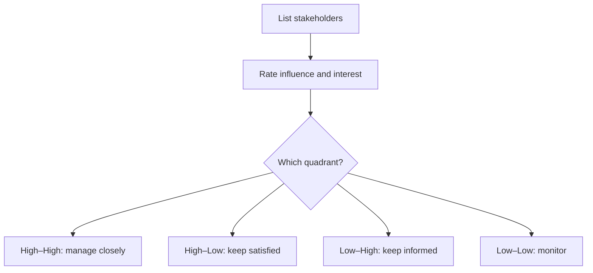

> This module lets you turn a vague request into a project with a clear goal, firm boundaries and the right people involved.

## What you'll be able to do
- Write a goal that anyone can check at the end of the project.
- Draw the line between what the project delivers and what it doesn't.
- Find every stakeholder and decide how closely to involve each one.
- Get a one-page charter approved before work starts.

## The big idea
Most projects fail at the start, not the end. A project with a fuzzy goal, open-ended scope or a forgotten stakeholder looks fine for weeks, then collapses into rework. Defining the project means writing down three things before anyone starts: what success looks like, what is in and out, and who must agree.

## Goals that can be checked
**What and why:** A **project goal** is the single outcome the project exists to produce. A goal is only useful if two people can look at the finished work and agree whether it was met. **SMART** is a test for that: a goal is Specific, Measurable, Achievable, Relevant and Time-bound.

1. **Specific:** names one outcome, not a direction ("launch the booking page", not "improve bookings").
2. **Measurable:** states the number or condition that proves it.
3. **Achievable:** fits the people, money and time you actually have.
4. **Relevant:** serves a reason the sponsor cares about.
5. **Time-bound:** has a date.

**Example:** "Improve the volunteer sign-up process" becomes "Volunteers can sign up online in under 3 minutes by 1 March, replacing the paper form."

**Watch out:** A goal with no number turns every review into a debate. If you can't measure it, rewrite it before you plan.

## Scope: in and out
**What and why:** **Scope** is the complete list of what the project will deliver. The **out-of-scope list** names what it won't, so that nobody assumes it. **Scope creep** is the slow addition of unplanned work without more time or money, and it is the most common reason small projects run late.

1. List the **deliverables**, the tangible things handed over at the end.
2. For each, write one line on what "done" means.
3. Write the out-of-scope list: the requests you already know you are refusing or postponing.
4. Agree on a **change process**: every new request is written down, sized, and approved or refused by the sponsor.

| | In scope | Out of scope |
|---|---|---|
| Purpose | What you promise | What you protect yourself from |
| Written as | Deliverables with a "done" line | Named features or tasks |
| Changed by | The change process only | Moving an item in, through the change process |
| Best when | Always | Always, especially for items stakeholders have already asked for |

**Watch out:** Saying "yes, small change" in a hallway is how creep starts. Route every request through the change process, even the small ones.

## Stakeholders
**What and why:** A **stakeholder** is anyone who affects the project or is affected by it. The **sponsor** is the stakeholder who funds the project and makes the final call. Missing a stakeholder means discovering their requirements after you have built the wrong thing.

1. List everyone who pays for, uses, approves, builds or is disrupted by the work.
2. Rate each on **influence** (can they change the project?) and **interest** (are they affected?).
3. Place them on a **power–interest grid** and pick an approach for each quadrant.

**Example:** For a new office booking system, the facilities manager is high-influence and high-interest, so they review each draft. The cleaning contractor is low-influence but affected, so they get a short email before launch.

## The project charter
**What and why:** A **project charter** is a one-page document that records the goal, scope, stakeholders, budget and key dates, signed by the sponsor. It gives the project manager the authority to start and gives everyone one page to point to when memories differ.

A charter contains:
1. **Goal** in SMART form.
2. **Scope** and the out-of-scope list.
3. **Stakeholders** and the sponsor.
4. **Budget** and **key dates** (milestones).
5. **Known risks** and assumptions.
6. **Sign-off** from the sponsor.

**Watch out:** A charter that nobody signed has no authority. Get the sponsor's sign-off before you assign the first task.

## Put it to work

### A manager hands you a one-line request
- [ ] Ask what problem the request solves and who asked for it.
- [ ] Rewrite the request as a SMART goal and confirm it with the requester.
- [ ] List three things the project will deliver and three it won't.
- [ ] Name the sponsor and get their agreement in writing.

### A stakeholder asks for "one more thing"
- [ ] Thank them and write the request down.
- [ ] Estimate its effect on time and cost.
- [ ] Take it to the sponsor through the change process.
- [ ] Tell the stakeholder the decision and update the scope list.

### Kick-off is next week
- [ ] Draft the charter on one page.
- [ ] Walk the sponsor through it and collect the signature.
- [ ] Send it to every stakeholder on the grid with their role highlighted.

## Recap
- Define the goal, scope and stakeholders before any work starts.
- A goal is only useful if it is SMART and can be checked at the end.
- Write what is out of scope as carefully as what is in.
- Every new request goes through the change process.
- Rate stakeholders by influence and interest, and engage each quadrant differently.
- A signed one-page charter gives the project its authority.

## Glossary
| Term | Meaning |
|---|---|
| Change process | How new requests are logged, sized and approved or refused. |
| Deliverables | Tangible things the project hands over at the end. |
| Influence | A stakeholder's power to change the project. |
| Interest | How much a stakeholder is affected by the project. |
| Out-of-scope list | What the project explicitly will not deliver. |
| Power–interest grid | A 2×2 grid that sets how to engage each stakeholder. |
| Project charter | A signed one-page record of goal, scope, people, budget and dates. |
| Project goal | The single, checkable outcome the project exists to produce. |
| Scope | The complete list of what the project will deliver. |
| Scope creep | Unplanned work added without more time or money. |
| SMART | Specific, Measurable, Achievable, Relevant, Time-bound. |
| Sponsor | The stakeholder who funds the project and decides. |
| Stakeholder | Anyone who affects or is affected by the project. |
