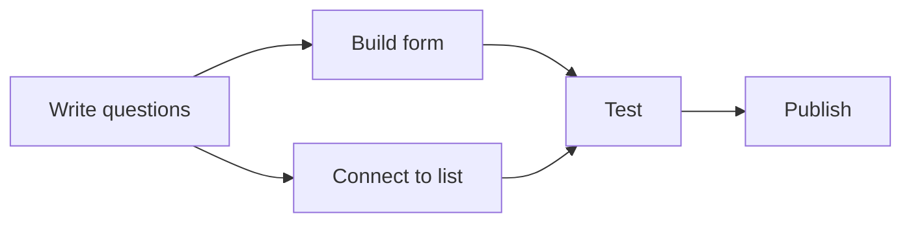

> This module lets you turn a signed charter into a schedule people trust, and keep it honest once work begins.

## What you'll be able to do
- Break the scope into tasks small enough to estimate and assign.
- Estimate each task with a range instead of a guess.
- Find the chain of tasks that sets the finish date.
- Report status so problems surface while they are still cheap.

## The big idea
A schedule is a forecast, not a promise. You build it from small, estimated tasks in the right order, then you watch the few tasks that decide the end date. Tracking means comparing the forecast with reality every week and acting on the gap early.

## Breaking down the work
**What and why:** A **work breakdown structure (WBS)** splits each deliverable into smaller pieces until each piece is a **task**: one action, one owner, a clear finish. Small tasks are easier to estimate, assign and check.

1. Start from the deliverables in the charter.
2. Split each into the parts needed to produce it.
3. Keep splitting until each piece takes one person about a day to a week.
4. Give every task an owner and a "done" line.

**Example:** "Online sign-up form" splits into: write the form questions, build the form, connect it to the volunteer list, test with five volunteers, publish.

**Watch out:** A task that takes a month is a phase in disguise. Split it, or it will hide its delays until the end.

## Estimating with three points
**What and why:** A single guess hides uncertainty. A **three-point estimate** asks for an optimistic (O), most likely (M) and pessimistic (P) duration, then blends them. The common blend weights the most likely case four times:

Estimate = (O + 4M + P) ÷ 6

| Task | O | M | P | Estimate |
|---|---|---|---|---|
| Build the form | 2 days | 3 days | 7 days | 3.5 days |
| Test with volunteers | 1 day | 2 days | 3 days | 2 days |

**Watch out:** Ask the person doing the task for the three numbers. Estimates you write for other people are wishes.

## Dependencies and the critical path
**What and why:** A **dependency** means one task can't start until another finishes. The **critical path** is the longest chain of dependent tasks. It sets the earliest finish date, so any delay on it delays the whole project. Tasks off the path have **float**, slack they can use without moving the end date.

1. Draw each task and the arrows between dependent tasks.
2. Add up durations along every path from start to finish.
3. The longest path is the critical path. Watch it daily.

**Example:** In the chart, if building the form takes longer than connecting to the list, the path through "Build form" is critical. A one-day slip there moves the publish date by one day.

## Tracking and status reports
**What and why:** A **status report** compares the plan with reality and asks for decisions. A **RAG status** (Red, Amber, Green) gives readers the answer in one word: Green is on track, Amber is at risk with a plan to recover, Red needs a decision from above.

A good weekly report has:
1. Overall RAG status and one sentence on why.
2. Done this week, and next week's plan.
3. Risks and issues, each with an owner.
4. Decisions needed, with a deadline.

**Watch out:** Projects rarely go from Green to Red. When something stays Amber two weeks running, escalate it.

## Put it to work

### Turning a charter into a schedule
- [ ] Break each deliverable into tasks of a day to a week.
- [ ] Collect three-point estimates from the task owners.
- [ ] Draw the dependencies and mark the critical path.
- [ ] Share the schedule with the sponsor and agree on the milestones.

### A critical task slips by two days
- [ ] Confirm the new estimate with the owner.
- [ ] Check which later tasks and milestones move.
- [ ] Look for float elsewhere to absorb it, or work to cut.
- [ ] Mark the project Amber and say so in this week's report.

### Writing Friday's status report
- [ ] Set the RAG status and write the one-line reason.
- [ ] List what finished and what starts next week.
- [ ] Give each risk an owner and a next step.
- [ ] State each decision you need and by when.

## Recap
- Split the work until each task has one owner and takes a day to a week.
- Estimate with a range: (O + 4M + P) ÷ 6.
- The critical path sets the finish date; watch it closely.
- Float is slack that off-path tasks can use without moving the end.
- Report status weekly with RAG, risks with owners and decisions with deadlines.
- Escalate anything that stays Amber for two weeks.

## Glossary
| Term | Meaning |
|---|---|
| Critical path | The longest chain of dependent tasks; it sets the finish date. |
| Dependency | One task can't start until another finishes. |
| Float | Slack a task can use without moving the end date. |
| RAG status | Red, Amber or Green summary of project health. |
| Status report | A regular comparison of plan and reality, with decisions needed. |
| Task | One action, one owner, a clear finish. |
| Three-point estimate | Optimistic, likely and pessimistic durations, blended. |
| Work breakdown structure (WBS) | Deliverables split into tasks small enough to estimate. |
