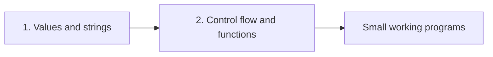

> This course lets you write small Python programs that read values, make decisions, repeat work and reuse logic.

## How the course fits together
**Module 1, Values, variables and strings**, covers what data looks like in Python: types, conversion between them, and building text with f-strings and string methods.

**Module 2, Control flow and functions**, puts that data to work: conditions pick a path, loops repeat it, and functions package it for reuse.

## Core concepts

### Types drive behaviour
Every value has a **type** (`str`, `int`, `float`, `bool`). Operations only work between compatible types, so convert with `int()`, `float()` or `str()` first.

### Blocks are indentation
A **block** is the indented code under a line ending in `:`. Conditions, loops and functions all own a block.

### Return, don't print
A **function** gives a value back with `return`. Without it, the caller gets `None`.

## Workflows

### Turn text input into a calculation
1. Read the values as strings.
2. Convert with `int()` or `float()`.
3. Compute.
4. Show the result with an f-string such as `f"{total:.2f}"`.

### Write a reusable function
1. `def name(params):` with defaults where useful.
2. Put the logic in the indented block.
3. `return` the result.
4. Call it with different arguments.

## Errors and fixes
| Symptom | Cause | Fix |
|---|---|---|
| `TypeError: can only concatenate str (not "int") to str` | Adding text and a number | Convert one side with `str()` or `int()` |
| `IndentationError: expected an indented block` | No indented block after `:` | Indent the block by four spaces |
| Function result is `None` | The function prints instead of returning | Add `return` |
| Loop misses the last number | `range(n)` stops before `n` | Use `range(n + 1)` |

## Cheat sheet
| Command / function | Does | Example |
|---|---|---|
| `type(x)` | Shows the type | `type(3.5)` |
| `int()` / `float()` / `str()` | Convert | `float("19.99")` |
| f-string | Insert and format values | `f"Total: {t:.2f}"` |
| `s[i]`, `s[a:b]` | Index and slice | `word[0:3]` |
| `len(s)` | Length | `len("python")` |
| `.upper()`, `.replace()` | New transformed string | `word.replace("py", "PY")` |
| `if` / `elif` / `else` | Choose a branch | `if temp > 30:` |
| `for x in seq` | Repeat per item | `for i in range(3):` |
| `while cond` | Repeat while true | `while count > 0:` |
| `def f(a, b=1)` | Define a function | `def area(width, height=1):` |
| `return` | Send a value back | `return width * height` |
