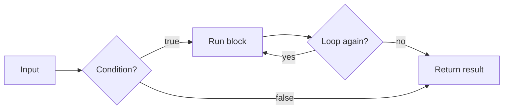

> This module lets you write programs that make decisions, repeat work and package logic into reusable functions.

## What you'll be able to do
- Choose between paths with `if`, `elif` and `else`.
- Repeat work over a collection with `for`, and until a condition changes with `while`.
- Write functions with parameters, defaults and return values.
- Read an `IndentationError` and fix it.

## The big idea
Programs run top to bottom unless something changes the flow. Conditions choose a path, loops repeat a block, and functions name a block so you can run it again with different inputs. In Python, the block is defined by indentation, so whitespace is part of the syntax.



## Decisions with if, elif and else
**What and why:** `if` runs its block only when the condition is true. `elif` checks another condition when the earlier ones failed, and `else` catches everything left. Python checks from the top and runs only the first matching block.

```python
temp = 31
if temp > 30:
    print("hot")
elif temp > 15:
    print("mild")
else:
    print("cold")
```
Output:
```
hot
```

**Watch out:** A missing indent after the colon fails with `IndentationError: expected an indented block after 'if' statement`. Indent the block by four spaces.

## Loops
**What and why:** A **for loop** runs its block once per item in a sequence, such as a list or `range(n)`. A **while loop** repeats as long as its condition stays true, so something inside it must eventually make the condition false.

```python
for fruit in ["apple", "fig", "kiwi"]:
    print(fruit, len(fruit))
for i in range(3):
    print(i)
```
Output:
```
apple 5
fig 3
kiwi 4
0
1
2
```

```python
count = 3
while count > 0:
    print(count)
    count -= 1
print("lift-off")
```
Output:
```
3
2
1
lift-off
```

| | `for` | `while` |
|---|---|---|
| Repeats | Once per item | While a condition is true |
| Stops | When the items run out | When the condition becomes false |
| Risk | Few | An infinite loop if nothing changes the condition |
| Best when | You know the items or the count | You wait for a state to change |

**Watch out:** `range(3)` gives 0, 1 and 2, not 3. The end number is never included.

## Functions
**What and why:** A **function** is a named, reusable block defined with `def`. **Parameters** receive the inputs; a **default value** makes a parameter optional. `return` sends a result back to the caller. A function without `return` gives back `None`.

```python
def area(width, height=1):
    """Return the area of a rectangle."""
    return width * height

print(area(4, 5))
print(area(4))
```
Output:
```
20
4
```

```python
def greet(name):
    print("Hi", name)

result = greet("Ada")
print(result)
```
Output:
```
Hi Ada
None
```

**Watch out:** Printing is not returning. `greet` shows text but returns `None`, so `result` holds nothing useful. Use `return` when the caller needs the value.

## Try it

### Grade checker
Turn a score into a grade.
- [ ] Write `grade(score)` that returns `"A"` for 90 and above, `"B"` for 75 and above, and `"C"` otherwise.
- [ ] Use `if`, `elif` and `else`.
- [ ] Call it in a `for` loop over `[95, 80, 60]` and print each result.

### Countdown function
Package the countdown as a function.
- [ ] Write `countdown(n)` with a `while` loop.
- [ ] Give `n` a default of 3.
- [ ] Call it with and without an argument.

## Recap
- Indentation defines blocks; a missing indent is an `IndentationError`.
- `if` / `elif` / `else` runs only the first matching branch.
- `for` walks a sequence; `while` repeats until a condition turns false.
- `range(n)` stops before `n`.
- `def` names a block; parameters can have defaults.
- `return` gives a value back; without it, the function returns `None`.

## Glossary
| Term | Meaning |
|---|---|
| Default value | A parameter value used when the caller gives none. |
| For loop | Runs a block once per item in a sequence. |
| Function | A named, reusable block defined with `def`. |
| Parameters | Names that receive a function's inputs. |
| While loop | Repeats a block while a condition stays true. |
